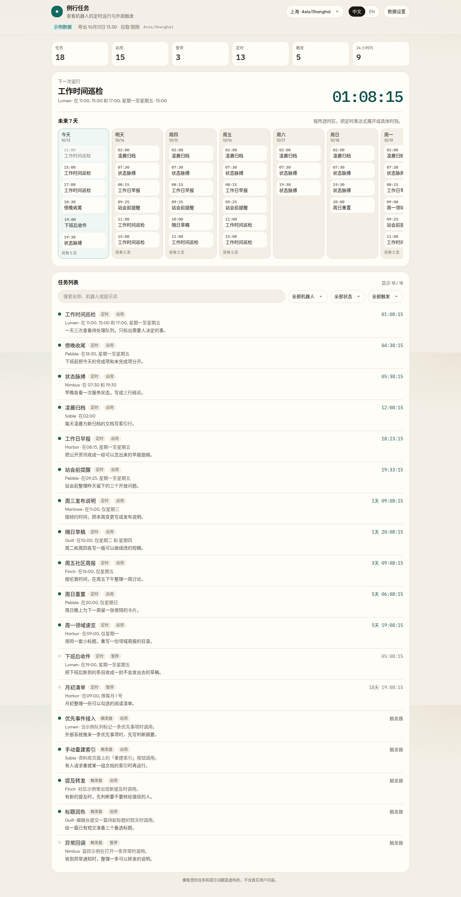
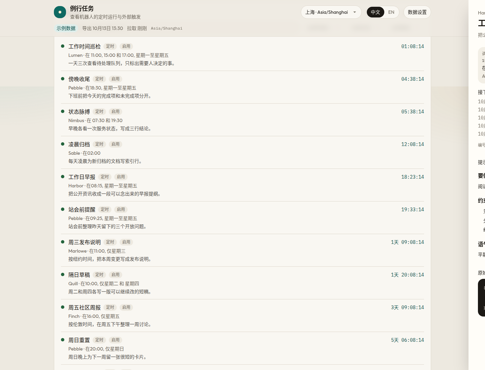
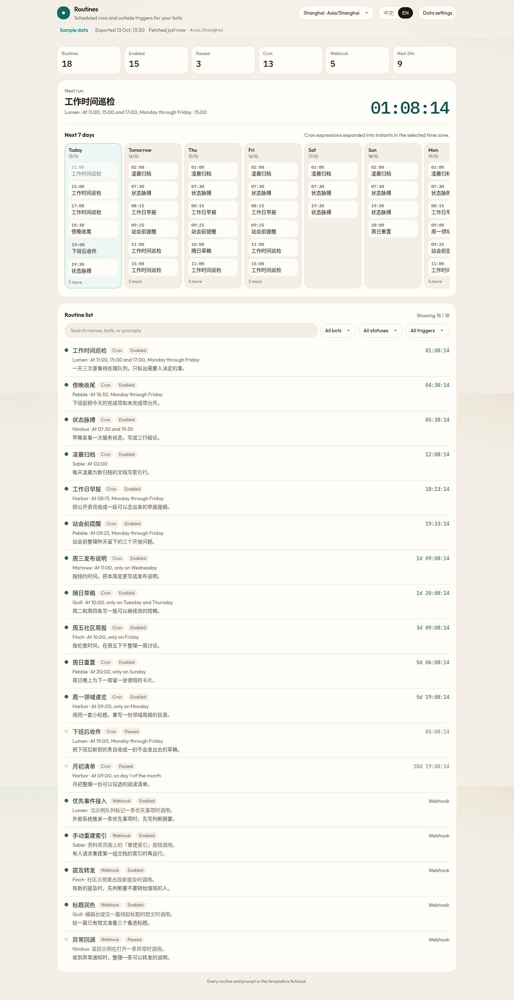
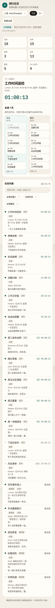

# Bot Routines Tracker

A static dashboard template for scheduled bot routines. It shows overview stats, a 7-day timeline computed from cron expressions, live countdowns, and a detail drawer. The bundled data is fictional. Point the app at your own JSON export when you want real routines.

Default language is Chinese. Switch to English from the header.



## Screenshots

| Overview | Detail drawer |
| --- | --- |
|  |  |

English UI:



Narrow screen:



## Quick start

```bash
npm install
npm run dev
```

Open [http://localhost:3000](http://localhost:3000). The page loads `public/routines.json`.

```bash
npm test
npm run lint
npm run build
```

`npm run build` writes a static site to `out/`. There is no Node server in production.

## What you get

- Counts for routines, enabled, paused, cron, webhook, and runs in the next 24 hours
- A 7-day timeline in a time zone you can change (default `Asia/Shanghai`)
- A per-second countdown to the next enabled cron run, and one on each scheduled row
- Plain-language cron text in the current UI language
- Filters for bot, status, and trigger type, plus search across names, bots, and prompts
- A drawer with the full prompt rendered as Markdown and the original trigger JSON
- A **新 / New** badge on routines that show up while the page is polling
- Export time, last fetch time, and a stale-data warning
- Chinese and English UI copy

The page refetches about every 45 seconds. Change `POLL_INTERVAL_MS` in `lib/preferences.ts` if you want a different interval.

## Data format

The file is a single JSON object. Version `1` is the only supported version. A copy of the schema lives in [`schema/routines.schema.json`](schema/routines.schema.json). The sample file is [`public/routines.json`](public/routines.json).

| Field | Required | Meaning |
| --- | --- | --- |
| `version` | no | `1`. Omit it or set it to 1. |
| `exportedAt` | recommended | ISO-8601 time the file was produced. Drives the “exported” clock and the stale warning. |
| `timezone` | no | IANA zone for cron routines that do not set their own. Default `Asia/Shanghai`. |
| `staleAfterMinutes` | no | Warn when `exportedAt` is older than this. Default 720 (12 hours). The sample uses 180. |
| `routines` | yes | Array of routine objects. |

Each routine needs `id`, `name`, `bot`, `status` (`enabled` or `paused`), `prompt` (Markdown), and `trigger`. `summary` and `updatedAt` are optional.

A cron trigger:

```json
{ "type": "cron", "expression": "15 8 * * 1-5", "timezone": "Asia/Shanghai" }
```

`expression` is a standard 5-field cron (`minute hour day-of-month month day-of-week`). `timezone` is optional and overrides the file zone. The timeline still draws those instants in the zone selected in the header.

A webhook trigger has no schedule. It appears in the list, not on the timeline:

```json
{ "type": "webhook", "path": "/hooks/example", "description": "Called by an example form." }
```

Rows that fail validation are skipped and listed on the page. The rest of the file still loads.

### Exporting from your own system

[`scripts/export-routines.example.mjs`](scripts/export-routines.example.mjs) is a starting point. It does not talk to any service. Replace the placeholder `SOURCE` array with jobs from your scheduler, map them into this shape, and write the file:

```bash
node scripts/export-routines.example.mjs > public/routines.json
```

To load a file hosted somewhere else, open **数据设置 / Data settings** and paste the URL, or open `/?data=https://example.com/routines.json`. The host must send CORS headers that allow the browser to read the JSON. If that request fails on first load, the page falls back to the bundled sample and says so.

Do not commit private prompts. The sample in this repo is fiction: invented bot names, generic instructions, and no real accounts.

## Deploy

The app is a static export (`output: "export"`). Set `PAGES_BASE_PATH` at build time when the site is not served from the domain root. Leave it empty for a root domain. An empty value is the local default, so `npm run dev` stays at `/`.

### GitHub Pages

This repository includes [`.github/workflows/pages.yml`](.github/workflows/pages.yml). On every push to `main` it runs the tests, builds with `PAGES_BASE_PATH=/bot-routines-tracker`, and deploys the `out/` folder with GitHub Actions.

One-time setup:

1. Settings → Pages → Build and deployment → Source: **GitHub Actions**.
2. Push to `main`.

The site is then at `https://dingyi.github.io/bot-routines-tracker/`.

If you fork the repo and the repository name is different, change `PAGES_BASE_PATH` in the workflow to `/your-repo-name`.

### Cloudflare

Create a Pages project from the repo (or upload `out/` after building locally).

- Build command: `npm run build`
- Output directory: `out`
- For a root domain such as `routines.example.com`, do not set `PAGES_BASE_PATH`
- For a subpath, set `PAGES_BASE_PATH` to that path, including the leading slash

### Any static host

```bash
PAGES_BASE_PATH= npm run build
```

Upload the `out/` directory. The host only needs to serve HTML, CSS, and JS. `public/.nojekyll` is included so a host that runs Jekyll does not drop the `_next` folder.

## Password gate

`NEXT_PUBLIC_GATE_PASSWORD` is optional. When it is set at **build** time, the page asks for that passphrase and remembers it in `sessionStorage`.

```bash
# .env.local for local dev, or a build environment variable
NEXT_PUBLIC_GATE_PASSWORD=choose-a-gate
```

See [`.env.example`](.env.example).

This is only a front-end gate. The passphrase is compiled into the JavaScript bundle, so anyone who can download the site can read it. It will not protect private routines. For real access control, keep the JSON off the public internet or put the host behind an actual gate such as Cloudflare Access.

## 中文

这是一个静态的机器人例行任务看板模板，用 Next.js、Tailwind CSS 和 Base UI 做成。仓库里的 `public/routines.json` 全是虚构数据：假的机器人名字、泛泛的提示词，定时和 webhook 都有，有的启用、有的暂停。界面默认中文，可以在页头改成英文。

### 本地运行

```bash
npm install
npm run dev
```

浏览器打开 [http://localhost:3000](http://localhost:3000)。构建静态文件用 `npm run build`，产物在 `out/`。

### 数据格式

根对象里最重要的是 `routines` 数组。建议同时写上 `exportedAt`（ISO-8601），页面用它显示导出时间，并在超过 `staleAfterMinutes` 后提示数据可能过期。文件级 `timezone` 默认 `Asia/Shanghai`。单条任务如果是定时，触发器写成：

```json
{ "type": "cron", "expression": "15 8 * * 1-5" }
```

五段标准 cron：分、时、日、月、周。webhook 没有固定时刻：

```json
{ "type": "webhook", "path": "/hooks/example", "description": "示例表单调用。" }
```

`prompt` 是 Markdown，在详情抽屉里整段渲染；原始触发 JSON 也在同一个抽屉里。完整字段见 [`schema/routines.schema.json`](schema/routines.schema.json)。

把自己的系统导出来时，改 [`scripts/export-routines.example.mjs`](scripts/export-routines.example.mjs) 里的示例数组，然后：

```bash
node scripts/export-routines.example.mjs > public/routines.json
```

也可以在「数据设置」里填一个 JSON 网址，或用 `/?data=` 传入。远程地址必须允许浏览器跨域读取。第一次加载失败时会退回内置示例，并在页面上说明。

页面大约每 45 秒重新拉取。轮询期间新出现的任务会标上「新」。时区可以改，时间线按所选时区展开，倒计时每秒走一格。

### 部署

这是纯静态站点。

- **GitHub Pages**：仓库已带 [`.github/workflows/pages.yml`](.github/workflows/pages.yml)。在仓库 Settings → Pages 里把 Source 设为 GitHub Actions，推送到 `main` 即可。本仓库的地址是 `https://dingyi.github.io/bot-routines-tracker/`。工作流里的 `PAGES_BASE_PATH` 是 `/bot-routines-tracker`。如果你 fork 之后仓库名变了，把这个路径改成新的仓库名。
- **Cloudflare**：构建命令 `npm run build`，输出目录 `out`。挂在域名根上时不要设置 `PAGES_BASE_PATH`。挂在子路径上时把它设成该路径（以 `/` 开头）。
- **其他静态空间**：本地执行 `npm run build`，把 `out/` 整个上传。`public/.nojekyll` 会一起带上，避免 Jekyll 丢掉 `_next`。

### 口令

构建时如果设置了 `NEXT_PUBLIC_GATE_PASSWORD`，打开页面要先输入这串口令。它只是浏览器里的一道门槛，口令会写进静态 JS，谁都能从源码里看到。不要用它保护真正的私密任务。需要真正的访问控制时，不要把 JSON 公开，或把托管放到 Cloudflare Access 这类服务后面。

## License

[MIT](LICENSE)
